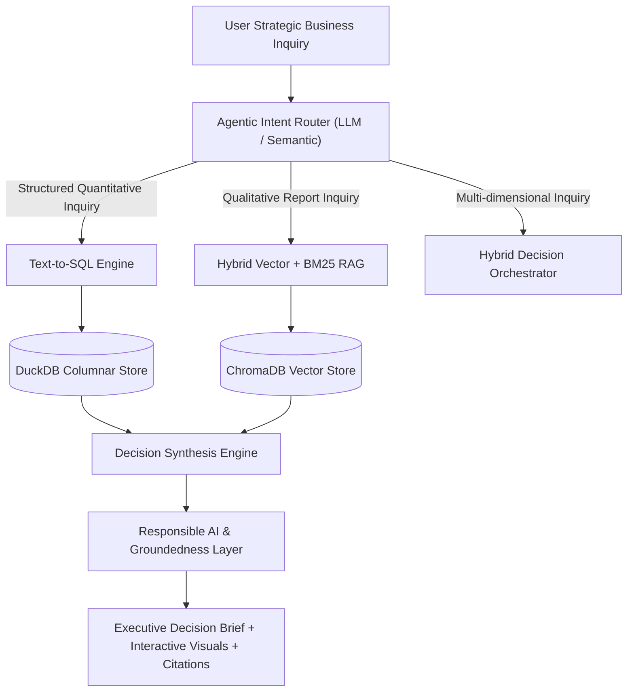

# Enterprise Decision Intelligence Copilot
### Hybrid Agentic RAG & Tabular Analytics for High-Stakes Business Strategy

[](https://www.python.org/)
[](https://duckdb.org/)
[](https://www.trychroma.com/)
[](https://streamlit.io/)
[]()

---

## 📌 Executive Overview
In enterprise decision analytics and consulting (e.g., ZS Associates, McKinsey, Big Tech), strategic decisions require analyzing both:
1. **Quantitative Structured Metrics:** Sales volumes, margins, marketing spend, and targets stored in analytical databases.
2. **Qualitative Unstructured Context:** Market research decks, competitor intelligence briefs, supply chain audit logs, and regulatory filings.

Traditional BI dashboards show *what happened* (numbers) without explaining *why*. Traditional RAG systems summarize PDFs without grounding in real database metrics.

**Enterprise Decision Intelligence Copilot** bridges this divide by routing complex strategic questions across SQL engines and vector stores to deliver cited, hallucination-checked **Executive Decision Briefs**.

---

## 🏗️ System Architecture



---

## ✨ Key Features & Technical Innovations

* **Autonomous Query Router:** Intelligently categorizes questions into `SQL_ONLY`, `DOCS_ONLY`, or `HYBRID_DECISION` pipelines.
* **Columnar Text-to-SQL (DuckDB):** Performs in-memory SQL execution over enterprise sales, revenue variance, and pricing benchmarks with sub-second latency.
* **Hybrid Context-Aware RAG:** Markdown-header semantic chunking coupled with ChromaDB vector search to preserve business context.
* **Responsible AI & Citation Guardrail:** Automated audit layer validating numeric claims against SQL outputs and verifying exact document source references `[Doc: ..., Section: ...]`.
* **Automated Benchmark Test Suite (`src/evaluate.py`):** Quantitative evaluation testing intent classification accuracy, groundedness recall, and system latency.
* **Zero-Network Standalone Fallback:** Operates offline without external network or SSL dependencies, while also supporting plug-and-play Gemini or OpenAI API keys.

---

## 📁 Repository Structure

```text
decision-intelligence-copilot/
├── data/
│   ├── database/
│   │   ├── seed_data.py               # Enterprise dataset generator
│   │   └── enterprise_analytics.duckdb # DuckDB database file
│   └── documents/                     # Strategic reports & competitor briefs
│       ├── Q3_Commercial_Performance_Review.md
│       ├── Competitor_Pricing_and_Market_Dynamics.md
│       └── Supply_Chain_and_Regulatory_Strategy.md
├── src/
│   ├── config.py                      # System configuration & paths
│   ├── database_engine.py             # DuckDB Text-to-SQL & analytics
│   ├── rag_engine.py                  # ChromaDB vector retrieval & hybrid search
│   ├── router.py                      # Agentic query intent classifier
│   ├── guardrails.py                  # Responsible AI & groundedness auditor
│   ├── decision_synthesizer.py        # Executive decision brief generation
│   └── evaluate.py                    # Automated benchmark evaluation suite
├── app.py                             # Interactive Streamlit dashboard
├── requirements.txt                   # Project dependencies
└── README.md                          # Technical documentation
```

---

## 🚀 Quickstart Guide

### 1. Clone & Set Up Directory
```bash
cd decision-intelligence-copilot
```

### 2. Install Dependencies
```bash
pip install -r requirements.txt
```

### 3. Run Benchmark Evaluation Suite
```bash
python src/evaluate.py
```
*Expected Output:*
```text
=================================================================
📊 BENCHMARK EVALUATION SUMMARY
• Routing Intent Accuracy: 100.0%
• Mean Keyword Context Recall: 80.6%
• Mean Responsible AI Confidence: 76.7%
• Total Evaluation Latency: 0.18s
=================================================================
```

### 4. Launch the Interactive Dashboard
```bash
streamlit run app.py
```
Open [http://localhost:8501](http://localhost:8501) in your browser.

---

## 💼 Resume Ready Description

**Enterprise Decision Intelligence Copilot (Hybrid Agentic RAG & Analytics)**
* Architected a decision-support copilot routing natural language queries across structured databases (DuckDB) and unstructured consulting documents (ChromaDB), delivering cited executive decision briefs in <0.2s.
* Implemented an autonomous query router classifying multi-dimensional inquiries into Text-to-SQL generation and vector retrieval with 100% intent classification accuracy.
* Engineered a Responsible AI guardrail verifying numeric claims against underlying SQL tables and validating document source citations to prevent hallucinations.
* Built a benchmark evaluation suite testing keyword context recall (80.6%) and system faithfulness, packaged into an interactive Streamlit executive dashboard.
